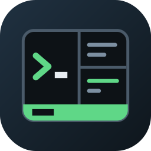
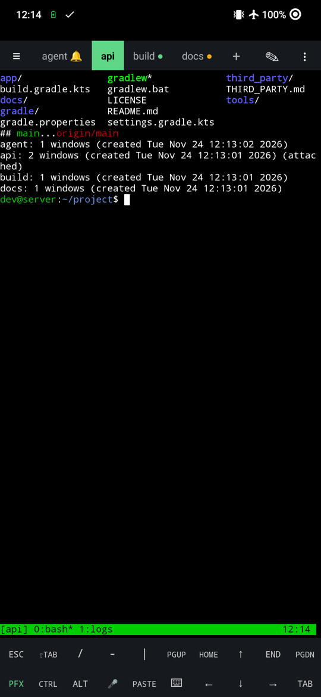
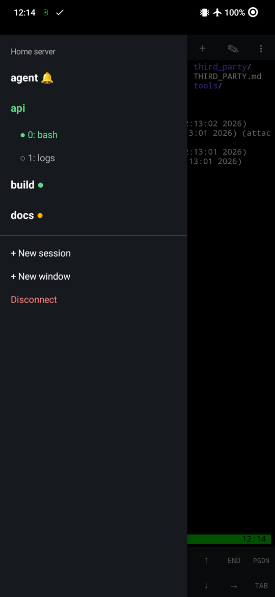
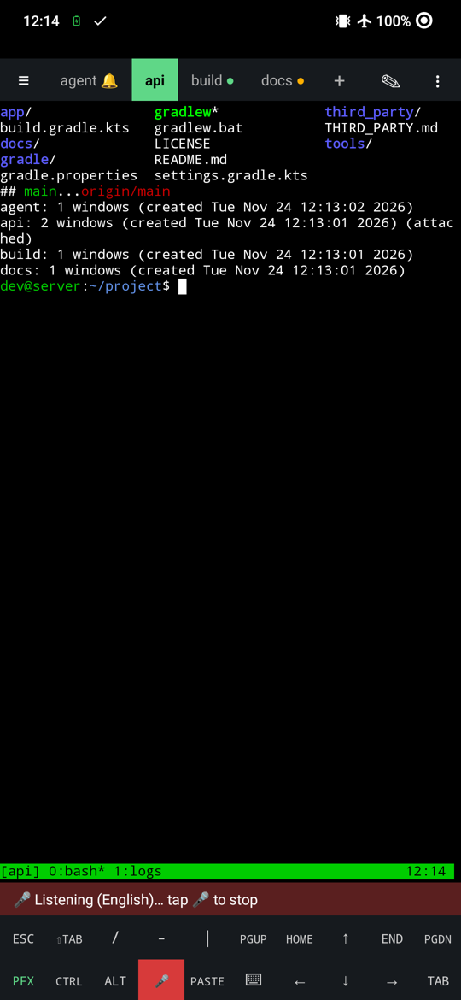
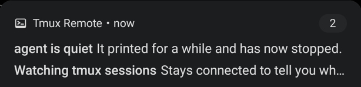
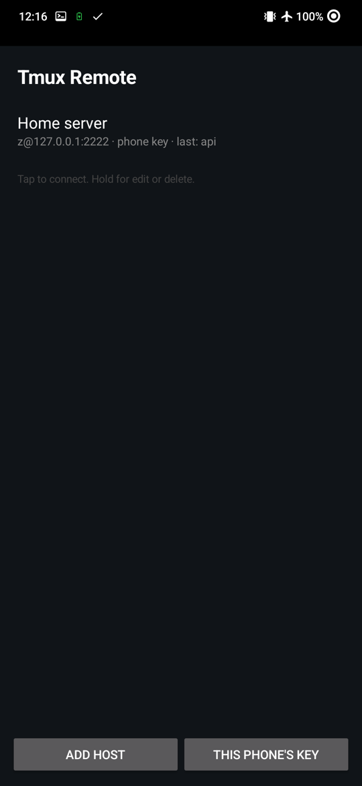
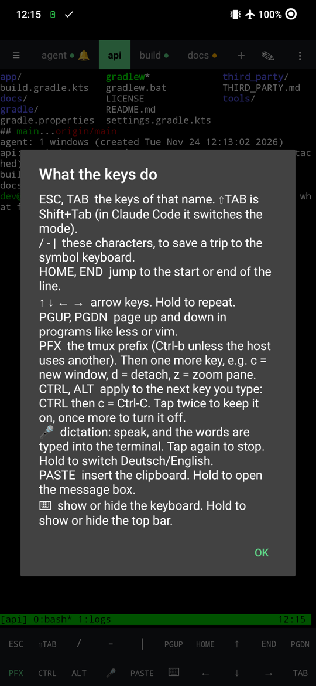

<h1 align="center">Tmux Remote</h1>

An Android app for one job: SSH to a machine and work in its tmux sessions from a phone.

A normal terminal app makes you type tmux prefix chords on a phone keyboard. This one talks to
tmux on a second channel, so switching sessions and scrolling are taps and swipes. Nothing has
to be installed or configured on the host besides `sshd` and `tmux`.

  
  
  

## What it does

- **Sessions as tabs.** Tap to switch, hold to rename or close, `+` for a new one. A drawer
  lists sessions with their windows. A sideways flick on the terminal goes to the next or
  previous session.
- **Scrolling by finger.** Drag on the terminal. In a plain pane the app puts tmux into copy
  mode and leaves it again at the bottom; in a full-screen program (less, vim) it sends wheel
  events or arrow keys, and page keys for Codex. `⤓` jumps back to the live bottom.
- **Key rows.** ESC, TAB, Shift+TAB, sticky CTRL and ALT (tap twice to lock), arrows, HOME/END,
  PGUP/PGDN, `/ - |`, PASTE, a keyboard toggle, a microphone key, and PFX, which sends the tmux
  prefix of the host. The menu has a short "What the keys do".
- **Activity marks.** A green dot on a tab means the session is printing right now, an amber
  dot means there is output you have not looked at.
- **Notify when quiet.** Hold a tab and choose it: you get a notification when that session
  printed for a while and then stopped for 20 seconds, or rang the bell. Useful for builds and
  long-running agents. While a session is watched, the app stays connected in the background.
- **Message box.** `✎` (or hold PASTE) opens a normal text field with autocorrect. Send pastes
  the text into the terminal and presses Enter.
- **Offline dictation.** The microphone key types what you say into the terminal, in German or
  English (hold the key to switch). The message box has the same as a Dictate button. Speech
  is turned into text on the phone itself; no audio leaves it.
- **Login** with a key made in the app, an imported private key, or a password. Secrets are
  encrypted with a key in the Android keystore. Host keys are asked once and checked afterwards.
- **Reconnects** by itself after a dropped connection.

   
  
  

## Install

Take the APK from the [releases](https://github.com/Zebsi235/tmux-remote/releases), or build it
yourself (below).
It needs Android 8 or newer on a 64-bit ARM phone and is about 100 MB because of the two speech
models.

First start:

1. Tap **This phone's key**, then **Copy as command**, and run that line once on the host. It
   adds the phone's public key to `~/.ssh/authorized_keys`.
2. Tap **Add host**, fill in host and user, then tap the host to connect.
3. The first connect shows the host's key fingerprint and asks whether to trust it.

## How it works

One SSH connection per host. The main channel has a pty and runs `tmux new-session -A`; its
bytes go to the terminal view. Short extra channels on the same connection run plain tmux
commands (`list-sessions`, `switch-client`, `copy-mode`, `send-keys`), which is how the app
drives tmux without typing into the terminal. The time of the last output per window, which
tmux reports, feeds the activity marks and the quiet rule.

| Path | What |
|---|---|
| `app/src/main/java/com/zebsi/tmuxremote/TmuxScripts.kt` | every command text sent to the host, and the parsers for the answers |
| `.../TmuxLink.kt` | connection, main channel, control channels, reconnect |
| `.../ActivityTracker.kt` | tab marks and the "went quiet" rule |
| `.../TerminalActivity.kt`, `ExtraKeys.kt` | terminal screen, tabs, drawer, key rows |
| `.../HostsActivity.kt`, `Store.kt` | host list, keys, encrypted storage |
| `.../App.kt` | notifications and the background service for watched sessions |
| `.../ComposeBox.kt`, `Dictation.kt` | message box and offline speech recognition |
| `app/src/main/java/com/termux/` | terminal emulator and view from Termux, with the session class rewritten for a remote stream |

## Build

    tools/fetch_speech_models.sh     # once: downloads the two speech models (about 90 MB)
    ./gradlew assembleDebug          # APK in app/build/outputs/apk/debug/

`./gradlew assembleRelease` builds the release variant. It is signed with your own key when a
`keystore.properties` (storeFile, storePassword, keyAlias, keyPassword) lies in the project
root, otherwise with the debug key.

JDK 17 and the Android SDK are needed. The speech models are not in git; without them the app
builds and runs, only Dictate fails. `tools/build.sh` runs the same build on another machine
over SSH, for when the machine at hand is too small for Gradle.

## Tests

    ./gradlew testDebugUnitTest

- `TmuxScriptsTest`: the command texts and parsers, including a shell syntax check of every
  script the app can send.
- `ActivityTrackerTest`: when a tab gets which mark and when a notification is due.
- `LinkIntegrationTest`: runs the app's real commands against a real host: login, attach,
  switch, scroll, new/rename/close, resize. It is skipped unless `TMUXREMOTE_TEST_HOST`,
  `TMUXREMOTE_TEST_USER` and `TMUXREMOTE_TEST_KEY` (an unencrypted ed25519 key with its `.pub`
  next to it, accepted by the host) are set. It only touches sessions named `zz-tmuxremote-*`.

Debug builds can also check the speech models on a phone: put a 16 kHz mono WAV at
`files/speechtest.wav` in the app's storage, start the app with the extra `speechtest` set to
`de` or `en`, and read the result from logcat (tag `TmuxRemoteSpeech`).

## Privacy

The app talks to the hosts you add and to nothing else. It has no accounts, no analytics and no
ads. Passwords and private keys stay on the phone, encrypted with a key from the Android
keystore. Dictation runs on the phone; the microphone is only used while the microphone key or
the Dictate button is active.

## Limits

- The key rows are fixed; they cannot be edited in the app yet.
- Dictation uses small models: lower-case text, no punctuation, and technical words are often
  wrong.
- Notifications can come late when Android has put the phone into deep sleep, unless the app
  is allowed to run unrestricted (it asks once).

## Licence

GPL-3.0, see [LICENSE](LICENSE). The terminal emulator and view come from Termux; the other
libraries and the speech models are listed in [THIRD_PARTY.md](THIRD_PARTY.md).
